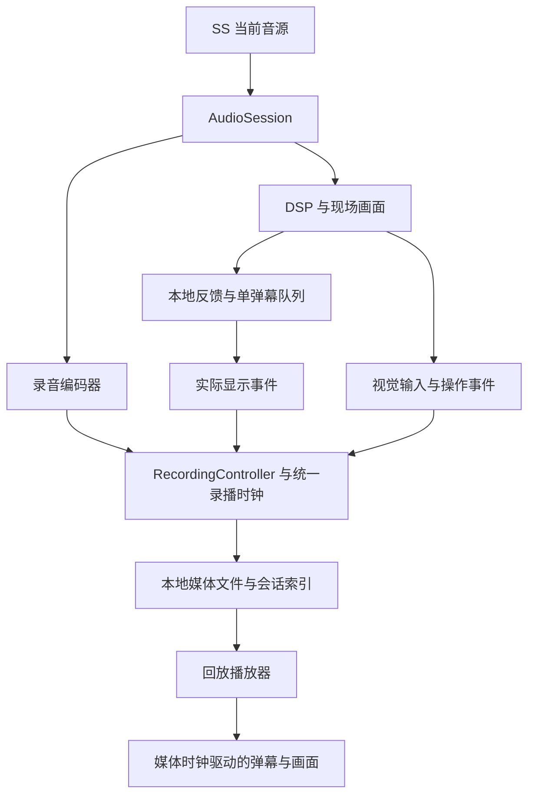

# SonoScope 内部录播与同步弹幕回看计划

## 1. 目标、依据与确认状态

本轮交付目标是：用户在 SS 内开始录制，现场及时看到有依据的弹幕；停止后保存完整会话，再次打开时听到原音频，并按原时间线看到弹幕和画面状态。**移动端与桌面端都是最终运行目标，桌面通过不能代替移动端完成。**

直接依据为用户在 2026-10-24 的两项要求：

- “重要的是要及时响应和录播后回看弹幕。”
- “是 ss 内部录播。你先写计划吧，一定要记得我们这个是最后要移动/桌面运行的。”

用户于 2026-10-24 在收到本计划后明确要求“你开始做吧”，本轮按文中推荐的会话录播、共享 Web 核心和轻量声学主链路实施。录播保真采用原音频、原弹幕与视觉状态的内部回放；平台适配保留移动与桌面目标。原生安装包、逐帧视频或后台持续录音如新增为必须能力，再确认对应范围。具体设备与最低版本仍由能力证据确定，既有分级反馈试验与模型失败记录继续保留。

相关依据：`README.md`、`docs/launch-validation.md`、[分级反馈试验](2026-10-24-p0-tiered-feedback-trial.md)、[反馈路线实测比较](2026-10-24-p0-feedback-direction-comparison.md)。旧文档中的具体模型、服务器或框架方案以当前入口代码和最新验证记录为准。

## 2. 用户体验与本轮范围

### 2.1 建议的完整流程

1. 在现有声音体验中点击“开始录制”。明确显示正在保存声音；录音权限沿用同一音频会话。
2. 录制过程中继续使用五个预设、弹幕开关和声音控制，显示已录时长、保存状态及剩余空间提示。用户仍可只体验而不录制。
3. 点击“停止并保存”，停止接收新的录播内容，完成音频封装和本地落盘，成功后显示可回看的会话。关闭声音时也要收尾录播，同时立即释放麦克风。
4. 从“我的录播”打开会话，播放、暂停、拖动、调整倍速，查看完整且可定位的弹幕记录。重开页面后会话仍可找到。
5. 用户可删除录播、导出备份并从 SS 备份恢复；删除不影响其他会话。备份属于本地录播管理，不扩展为导入任意外部视频的分析工具。

### 2.2 录播保存什么

**建议保存“音频＋实际显示的弹幕事件＋视觉输入和操作时间线”的会话包，在 SS 内重放。** 音频来自 SS 当前音源：麦克风优先；已有文件音源沿用同一个录制入口，不重复申请麦克风。

| 内容 | 保存及回放语义 |
| --- | --- |
| 音频 | 保存实际录入的声音；记录真实采样率、声道、编码格式和时长。录制不依赖云端。 |
| 弹幕 | 保存全部实际上屏的文字、来源、开始／结束时间和顺序，包含当时已显示的 AI 文字；未显示、被拒绝或过期的候选不混入。 |
| 画面 | 保存驱动画面的必要声音特征，以及预设、频谱、动态开关等操作；回看使用同一媒体时间恢复。 |
| 完整文字记录 | 与最近 12 条预览分开，支持按录播位置定位；长录播分页读取。 |

该会话方案可以适配不同屏幕，不必在录制时持续编码屏幕视频。**它不等于保存像素完全一致的视频文件**：当前粒子、随机数、帧数与 GPU 渲染受设备影响。若“录播”必须包含原画面的逐帧视频或 MP4 导出，应在实施前选择另一条录制路径，不能用重新绘制的画面冒充原始录像；具体分支见第 10 节。

### 2.3 实时反馈的建议取舍

- 为这条录播主链路提供明确的“声学反馈”模式：由 DSP 的音量、频谱和变化证据生成本地文字，不等待模型或网络。
- 建议该模式不启动分类 Worker、不下载分类模型及其推理 WASM；无有效证据时保持安静，不用固定开场语凑首条指标。
- 当前未通过真实录音验证的具体乐器、人声、数字 BPM 声称不进入该模式。内部周期估计若仍用于画面，不转换成面向用户的节拍断言。
- 是否把声学模式切为全应用默认，是本计划提出的产品变更；录播数据与回放本身不依赖该决定。原 YAMNet 模式可用于回归对照，新增乐器头不进入此计划。
- 可选 AI 维持既有显式开关及配额约束，不承担及时首条的保障。录播只保存已显示的结果；回看不重新调用 AI。开发验证默认关闭 AI。

## 3. 当前实现与缺口

| 已有实现 | 本轮必须补上的部分 |
| --- | --- |
| `packages/sdk/src/audio-session.ts` 独占输入、AudioContext 和采集资源 | 同源录音分支、录制开始／停止协调、编码与保存生命周期 |
| `packages/sdk/src/feature-pipeline.ts` 分离 DSP 与分类，PCM 有界 | 显式声学模式；录播时特征旁路写入，不能拖慢现场反馈 |
| `packages/danmu-pipeline/controller.ts` 仅在显示成功后增加 history，最多 12 条 | 独立、完整、可持久化的显示事件流；保留现场小队列的边界 |
| `packages/danmu-pipeline/dom-sink.ts` 用 `performance.now()` 驱动动画 | 媒体时钟驱动的回放入口；显示及提前移除回执 |
| `CommentCandidate` 有墙钟 `createdAt`／`expiresAt` | 独立的录播时间契约，不能把墙钟或临时 TTL 当媒体位置 |
| 文件输入在 `AudioSession` 内创建隐藏的 audio 元素 | 可观察的播放器、暂停／定位／倍速及其同步状态 |
| `app/components/visualizer.tsx` 消费实时帧，部分 shader 使用 `p.millis()`，Mosaic 依赖帧数和随机数 | 可注入的回放时间和特征；定位时重置及重建状态，明确视觉保真边界 |
| 现有前台浏览器试验有及时首条；原模型有受控 30 分钟桌面成绩 | 新模式加录音、存储、回放之后的两端实机质量与性能验收 |

现有 9 段试验从选择文件到首条可见约 2.2–3.8 秒；其内部显示延迟 1–87 ms 不包括全部加载及采集等待。原模型的 Worker 计算 p95 12.56 ms 也不是用户感知的首条延迟。BPM 仍有 200→100 的确定失败。上述数据仅是基线，不作为本计划已通过的证据。

## 4. 架构与关键接口

以下结构用于说明设计方向，不是可复制的实现代码。领域对象和行为边界在实现时应保持，具体类型名可按仓库规范细化。

### 4.1 分层职责

| 模块 | 关键行为与边界 |
| --- | --- |
| RecordingClock | 维护音源时间、单调时钟、编码后媒体时间的映射；记录分段和中断。墙钟只用于日期展示。 |
| RecordingController | 管理准备、录制、收尾、保存成功、中断及失败；协调媒体、弹幕、视觉事件，不取得麦克风所有权。 |
| RecorderBackend | 使用平台录音能力，从当前音源创建可释放录音分支；报告实际格式、数据、结束和错误。 |
| RecordingStore | 写入媒体与事件、提交检查点、列举／打开／删除／导出／恢复会话；隐藏 OPFS、IndexedDB 或未来宿主文件实现。 |
| PlaybackController | 以播放器媒体位置为唯一回放时间源，管理暂停、定位、倍速、结束与异步加载代次。 |
| ReplayTimeline | 按时间索引查询可见弹幕、特征和操作；不调用生成器、实时队列或网络。 |
| UI | 提供录制状态、会话库、播放器及错误恢复；同一业务层适配触摸和鼠标键盘。 |

### 4.2 录播契约

新建独立版本的本地录播 schema，不把完整录播或音频加入现有 v2 AI 请求。

| 对象 | 必要信息与约束 |
| --- | --- |
| 会话清单 | recordingId、schema 版本、创建日期、应用／渲染版本、状态、音源类型、实际格式、时长、大小、媒体引用、校验和、最后提交序号 |
| 媒体段 | 段编号、字节范围、已提交字节、采样／编码信息、媒体起止、明确的中断；数据未完成时不伪造已验证时长 |
| 弹幕事件 | 独立 eventId、原 commentId、文本、来源、实际显示起止 mediaTime、原顺序、必要呈现设置；可另存声音证据位置作诊断 |
| 视觉输入 | 有界频率的实际渲染输入、时间、有效性；保留预设实际消费的频带等字段，不保存完整分类输出或无用特征 |
| 操作事件 | 预设、频谱／动态／弹幕开关、必要视觉参数和中断事件，使用同一媒体时间 |

`audioSessionId`、`danmuRunId` 继续隔离现场异步回调；`recordingId` 独立拥有录播生命周期。`playbackRunId` 隔离回放中的旧定位和旧加载结果。切换现场弹幕开关不得重置整段录播。

### 4.3 统一时钟与同步

- 录音开始只建立一次媒体起点；不把点击按钮、收到第一个 Blob 或首条弹幕当作音频零点。
- 用户在现场体验中途开始录制时，同步记录起点的预设、视觉参数及仍可见弹幕；这些已有弹幕的录播区间从 0 开始截取，并与随后回执按事件身份去重。停止录制时所有可见区间截断到实际录音终点，不能因现场继续运行而延长存档。
- 记录 AudioContext／PCM 时间与单调时钟的锚点，编码后校核媒体首帧、尾帧及累计时长。编码起始偏移、padding、暂停或系统中断需记录，不能仅用 `Date.now() - start`。
- `MediaRecorder` 的 `timeslice` 只是请求分块频率，不是时间戳；移动端回调可能延迟，单个数据块也未必能独立播放。不能用“块数×间隔”推导录播时长。[MediaStream Recording 规范](https://www.w3.org/TR/mediastream-recording/)、[dataavailable 的平台限制](https://developer.mozilla.org/en-US/docs/Web/API/MediaRecorder/dataavailable_event)。
- 实际显示回执绑定当时的媒体位置。AI 等延迟结果按真正出现的位置回放，不能回填到它描述的早先声音位置而改变现场记录。
- 队列接收或 `show` 返回成功只代表接受显示，存档还要确认下一可见绘制帧中的实际呈现；在呈现前被移除的节点不计为已看到。页面隐藏期间不把新节点登记为可见弹幕，恢复后按实际呈现处理。
- 回看以媒体元素 `currentTime` 为主，结合播放状态调度可见帧；`timeupdate` 不能作为唯一高频动画调度。暂停冻结弹幕进度，倍速按媒体时间推进。[HTML 媒体时间与定位规范](https://html.spec.whatwg.org/multipage/media.html)。
- 定位时清除旧视图、取消旧读取，用索引恢复目标时间仍可见的弹幕及其进度；不把跳过的评论批量补发。向后定位再次显示原事件是正常回看，不重复写入录播统计。

### 4.4 录制与保存生命周期

| 状态 | 进入条件与用户可见结果 |
| --- | --- |
| 准备中 | 检查录音和存储能力、申请必要权限、创建临时清单；失败不显示正在录制 |
| 录制中 | 音频与事件持续分块保存；明确区分“正在录制”和“已保存到哪一阶段” |
| 保存中 | 停止新内容，等待最后数据和编码器 stop，再校核媒体、提交索引；不可提前报告保存成功 |
| 已保存 | 正常收尾、媒体可解码且时长／事件范围一致，可进入会话库回放 |
| 已中断／部分可恢复 | 被系统中断或异常退出；仅展示经检查可播放的前缀，告知缺失尾部，不改成完整录播 |
| 保存失败 | 空间、写入或编码失败；保留已提交材料及恢复路径，不删除其他录播腾空间 |

“停止录制”可保留现场声音体验。“停止声音”立即关闭输入资源，同时允许已截断录播进行有界收尾；不能为等待磁盘而继续占用麦克风。录制保存超时有明确失败状态，晚到回调不得写入下一段。

已落实的收尾接口：原生编码器停止时，通过录音分支的 `finalizeAfter(completion)` 登记最后数据／stop 的完成 Promise。`AudioSession` 立即断开现场分析、文件／麦克风输入并停止输入轨道，只把录音分支和已断开输入的上下文保留至编码收尾完成；最长 10 秒强制释放。直接销毁整个上下文可能早于编码器交出尾部，不能用提高时长容差掩盖这类问题。

连续录制采用平台 `MediaRecorder`，录音数据持续落盘。**正常 stop 后完整媒体的可播放保证，不等于进程被杀后每个已写入块都可恢复。** 异常恢复要按编码格式校验，不能承诺固定只丢最后一秒；若产品要求严格无损崩溃恢复，需另外选择分段封装／原生录制方案。

### 4.5 本地存储与轻量运行

- 建议媒体文件优先写 OPFS；会话索引和分页事件写 IndexedDB。兼容路径使用 IndexedDB 的编码数据块，必须通过同样的保存、定位和内存测试。OPFS 的同步写句柄仅放专用 Worker。[WebKit OPFS](https://webkit.org/blog/12257/the-file-system-access-api-with-origin-private-file-system/)。
- 音频与元数据跨存储提交使用检查点和最终清单：先写媒体，再提交可引用范围；删除使用墓碑与可重试清理。重启扫描未完成会话及孤立文件，不把两套存储误当一个原子事务。
- 写入排队有字节和时间上限；先保存音频和弹幕，视觉输入按明确策略采样。磁盘跟不上时停止录播并说明原因，不丢弃音频／弹幕后仍宣称完整。
- 不累计整段 PCM、不每帧序列化大对象、不在停止时一次解码整段录音。编码 Blob 用流式写入；回放使用媒体文件与分页预取。
- 开始前及录制中检查存储估计，并处理实际 `QuotaExceededError`。可申请持久存储，但获批与浏览器保留策略不作保证；提供本地备份与恢复。[WebKit 存储策略](https://webkit.org/blog/14403/updates-to-storage-policy/)。
- 备份建议采用带版本清单的 ZIP 会话包，已编码音频无需再次压缩，写入和恢复均可分块。只恢复 SS 会话；媒体格式仍需当前设备可解码。跨设备备份互通必须单列验证，不能由“两端都能运行”推断成立。
- 初始容量估算：96–128 kbps 音频约 21.6–28.8 MB／30 分钟，另加视觉事件与索引。码率可能不按请求执行，必须显示实际占用；此为估算，不是测试结果或硬性录制时长上限。
- 建议录播拥有的待写数据上限 8 MiB、事件／回放缓存 4 MiB，现场 PCM 仍满足既有小于 1 MiB 的边界。上述上限不包括浏览器编码器、GPU 或系统内存，后者必须单独实测。
- 声学模式建议最多一个 DSP Worker 与一个存储 Worker；回放不启动分类、AI 或麦克风。平台编码器的内部线程不计作应用 Worker，但其资源要进入总量观察。

## 5. 移动端与桌面端要求

### 5.1 目标矩阵

当前仓库是浏览器应用。本方案建议先以同一套 Web 核心覆盖以下最终运行环境；是否还要原生安装包属于第 10 节待确认的宿主范围。

| 平台 | 必须进行的实际验证 | 不可替代的项目 |
| --- | --- | --- |
| iPhone／iPad Safari | 至少一台目标手机；若支持平板则补目标平板。使用最终约定的系统下限和当前支持版本 | 手势启动、音频中断、锁屏／切后台、实际编码、存储、旋转、30 分钟录播与回看 |
| Android Chrome | 至少一台目标中档机，不能只测旗舰机 | 屏幕锁定、后台回调延迟、存储压力、热降速、30 分钟录播与回看 |
| macOS Safari、Chrome | 两种引擎均验证主流程 | 编码／定位、窗口后台与恢复、重启浏览器、资源释放 |
| Windows Edge、Chrome | 目标 Windows 版本上的真实浏览器 | 设备权限、编码、存储与长时录播回放 |

设备型号、RAM、系统和浏览器版本写入验收矩阵，不以 UA 判断代替能力探测。之前用户允许暂缓的手机测试只适用于先前轮次，**不能当作本功能最终发布时免测移动端的依据**。

### 5.2 平台差异的处理

- 用能力探测与短录／解码验证选择格式，记录实际 MIME。`isTypeSupported` 为真不足以证明整个录制、保存、定位流程可用；不假设所有 Safari 版本只支持一种格式。[Safari 18.4 的录音格式变化](https://webkit.org/blog/16574/webkit-features-in-safari-18-4/)。
- 手机前台是正常录播的验收场景。对锁屏、来电、切应用或音轨结束，记录真实中断并尽力收尾；不能承诺浏览器持续后台录制。若后台／锁屏持续录音是必须目标，应改用经过实测的宿主能力，不取消移动端要求。
- 页面可能被冻结或直接丢弃，不能把保存只放在 `unload`／`pagehide`。持续提交才是恢复基础；生命周期事件用于额外检查点，不能作为最后一次保存必到的保证。[Chrome 页面生命周期](https://developer.chrome.com/docs/web-platform/page-lifecycle-api)。
- 录制核心和回放调度放共享 SDK，平台录音／文件能力采用适配器。将来选择移动或桌面安装包时可替换宿主层；本次不擅自引入 Electron、Tauri 或 Capacitor。
- 320 px 窄屏、横屏、安全区、触摸拖动、键盘定位、焦点返回和减少动态均纳入 UI 验收。录制／播放／暂停动态必须分别表达，不能混为一个“暂停”。
- 当前有 Web App manifest，但未发现应用壳离线缓存实现。本计划的断网回放指页面已加载后的本地回看；若要求断网时从关闭的浏览器直接启动 SS，需在宿主决定中加入应用壳离线缓存、版本更新与旧录播兼容，不能把 manifest 当作离线能力已经完成。

## 6. 实施单元与依赖

依赖顺序：U0 → U1 → U2 → U3；U4 的反馈及回执设计依赖 U1，持久化联调依赖 U2；U5 依赖 U2／U4；U6 汇合 U3／U5；U7 验收所有单元。此为模块依赖，不是启动 agent 或并行工作空间的授权。

2026-10-24 实施状态：U1–U6 的共享核心和主页面已落地，最终构建的包构建、lint、225 条测试、类型与生产副本检查通过。录制、完整归档、暂停／定位／倍速、会话库及备份恢复已实现，最终短录复验已通过。勾选框仍按各单元原定的完整完成条件计；手机／Windows、Safari 前台及未执行的长时指标不记为通过。实际结果见[验证记录](../internal-recording-replay-validation.md)和[平台矩阵](../recording-platform-matrix.md)。

用户随后明确要求停止长测。本轮不再执行 30 分钟录制／30 分钟回看，把交付收口到完整功能、必要工程检查与针对已发现问题的短测；未测的长时指标保留为“未测”，不记为通过，也不再据此反复请求继续测试。

- [ ] **U0：冻结产品边界和两端能力矩阵**

  **目标／需求：** R2、R4、R6、R7。明确回看保真范围、最终宿主与设备下限，先验证录音格式、存储、时间映射及定位可行性。

  **依赖：** 第 10 节中影响平台及录播保真的产品决定。

  **文件：** 新建 `docs/recording-platform-matrix.md`、`test/browser/recording-probe.html`；测试 `test/launch/recording-capabilities.test.ts`；实测证据写入 `test/artifacts/recording-platform-*.json`。

  **方法与测试场景：** 每种必需引擎录制带已知时间标记的声音，保存、重开、定位开头／中间／末尾；覆盖编码不支持、构造器失败、权限拒绝、存储不可用和系统中断。这里只形成实现所需证据，不靠 API 存在即判通过。

  **完成条件：** 每个平台有明确可用路径及未解决项；失败平台保留为阻塞，不改成桌面限定版本。若需原生能力，先确认受影响的宿主方案。

- [x] **U1：录播契约、时钟与状态模型**

  **目标／需求：** R2、R3、R4、R6、R7。为录音、实际弹幕和回放建立同一时间定义。

  **依赖：** U0。

  **文件：** 新建 `packages/core/src/recording-contracts.ts`、`packages/sdk/src/recording-clock.ts`；修改 `packages/core/src/index.ts`、`packages/sdk/src/index.ts`；测试 `test/launch/recording-contracts.test.ts`、`test/launch/recording-clock.test.ts`。

  **方法：** 独立本地 schema，严格验证有限时间、索引、文本长度、数据范围和版本；不修改 AI 的 v2 音频隐私约束。沿用 `audioSessionId`／代次隔离思路，增加录播与回放自己的生命周期。

  **测试场景：** 墙钟被调整不改变录播位置；采样率 44.1／48 kHz；起始编码偏移和中断；旧回调到达新会话；未知版本、越界时间、重复序号；尾部媒体与弹幕范围不一致。

  **完成条件：** 模拟时钟下时间映射确定；异常状态不能被标记为完整保存，事件顺序可独立验证。

- [ ] **U2：持久化、会话库与恢复**

  **目标／需求：** R3、R5、R6、R7。完整记录独立于 12 条预览，录制时内存有界。

  **依赖：** U1。

  **文件：** 新建 `packages/sdk/src/recording-store.ts`、`packages/sdk/src/storage/recording-index.ts`、`packages/sdk/src/storage/recording-media.ts`、`app/lib/workers/recording-storage.worker.ts`；测试 `test/launch/recording-store.test.ts`、`test/launch/recording-recovery.test.ts`。

  **方法：** OPFS 媒体与 IndexedDB 索引分层；兼容存储遵守同一接口。使用检查点、最终清单和删除墓碑；导出／恢复验证大小、版本、校验和及内部路径，禁止不受控解压和脚本内容执行。沿用现有 SDK 资源唯一所有者与幂等释放模式。

  **测试场景：** 正常保存后刷新／浏览器重开；媒体已写而索引失败；配额耗尽、慢写、单个大 Blob；删除中断与重试；不完整媒体只恢复可播放范围；备份损坏／未知版本／重复恢复；同一会话禁止多个写入者。

  **完成条件：** 已保存会话内容完整；失败不损害其他会话；内存及写队列不随录制时长持续增长。无持久存储能力时明确拒绝开始录播，现场体验仍可工作。

- [ ] **U3：内部录音和音源生命周期集成**

  **目标／需求：** R2、R6、R7。SS 内显式开始和停止录制，同一输入同时供分析与录音。

  **依赖：** U1、U2。

  **文件：** 新建 `packages/sdk/src/recording-controller.ts`、`packages/sdk/src/recorder-backend.ts`；修改 `packages/sdk/src/audio-session.ts`、`packages/sdk/src/runtime.ts`、`packages/sdk/tsup.config.ts` 及实际需要的包导出；测试 `test/launch/recording-controller.test.ts`、`test/launch/audio-session.test.ts`。

  **方法：** `AudioSession` 保持麦克风／上下文所有权，提供受控录音分支；编码器不另建第二条输入。状态区分录制和保存；最后数据与 stop 完成后才能提交。切换源或进入回放前先完成／中断当前录播，单个会话不偷偷拼接不同源。

  **测试场景：** 麦克风和已有文件音源；正在显示弹幕时开始录制；连续点击开始／停止；准备中取消；最后 Blob 晚到；编码器异常；录制中结束声音或文件自然结束；拔出设备／拒绝权限；保存中退出页面；20 次启停资源归零。

  **完成条件：** 音频内容无重复或应用引入的截断；停止时及时关麦；保存成功对应真实可播放媒体；录音等待不阻塞弹幕主链路。

- [ ] **U4：及时声学反馈与实际显示事件**

  **目标／需求：** R1、R3、R7、R8。首条及时且有依据；存档记录用户实际看到的内容。

  **依赖：** U1；持久化联调依赖 U2。

  **文件：** 修改 `packages/core/src/sound-observation.ts`、`packages/danmu-pipeline/controller.ts`、`packages/danmu-pipeline/comment-queue.ts`、`packages/danmu-pipeline/dom-sink.ts`、`packages/sdk/src/feature-pipeline.ts`、`packages/sdk/src/runtime.ts`、`app/hooks/use-sonoscope.ts`；测试 `test/launch/music-feedback.test.ts`、`test/launch/danmu.test.ts`、`test/launch/dom-sink.test.tsx`、新建 `test/launch/recorded-comments.test.ts`。

  **方法：** 新模式明确禁用分类加载而不只是忽略输出；本地声学反馈独立于模型／网络。显示层区分接受显示、实际呈现和消失，涵盖优先替换、resize、开关和正常到期。归档异步读取呈现回执，不把存储耗时放入显示路径；全量记录和现场最多 12 条状态分开。

  **测试场景：** 静音无填充评论；低音量有效声音有证据才回应；雨声／讲话不说音乐或节拍；既有 200→100 BPM 失败不再进入新模式文字；未显示／过期候选不归档；起点已有弹幕与同帧新弹幕不丢不重；录制结束但现场继续时区间正确截断；提前移除和缩放正确封闭区间；关闭／重开弹幕不清空录播；AI 晚到按实际出现位置记录且不触发额外调用。

  **完成条件：** 冻结新声音样本后检验首条和全文质量；每条已显示事件恰好保存一次，归档压力不拖慢现场显示。

- [ ] **U5：同步播放器、完整文字记录与视觉回放**

  **目标／需求：** R4、R5、R7。回看读取原记录，与声音同进退。

  **依赖：** U2、U4；完整实录联调需要 U3。

  **文件：** 新建 `packages/sdk/src/playback-controller.ts`、`packages/sdk/src/replay-timeline.ts`、`packages/danmu-pipeline/replay-sink.ts`；修改 `app/components/visualizer.tsx` 及 `app/visuals/wave.ts`、`app/visuals/accretion.ts`、`app/visuals/spiral.ts`、`app/visuals/mochi.ts`、`app/visuals/mosaic.ts` 的时间输入边界；测试 `test/launch/playback-controller.test.ts`、`test/launch/replay-timeline.test.ts`、`test/launch/replay-sink.test.tsx`、`test/launch/visualizer-lifecycle.test.tsx`。

  **方法：** 播放器公开媒体时钟；时间索引分页预取。回放绕开实时 TTL、去重、生成器和云端；弹幕动画接收媒体位置。记录必要视觉输入，操作事件恢复五预设；定位时重建状态，采用有界预热／检查点，不能从第零秒同步重算整段。使用当前无障碍偏好，保存原文本及时间，不强迫用户观看动态。

  **测试场景：** 正播、暂停、0.5／1／1.5／2 倍速；连续向前／向后定位；定位到弹幕中间；跨预设、静音段及录音末尾；旧定位结果晚到；缺失事件块／不支持的录音格式；断网回放；回放时麦克风、分类、生成请求为零；窄屏文字完整可读。

  **完成条件：** 事件数据不丢不重；定位不会补发跳过内容或残留旧弹幕；原声音、文本、预设及操作时间一致。不同屏幕允许重新布局，不能以数据完整代替实际可见检查。

- [ ] **U6：两端录制／录播库／回放界面**

  **目标／需求：** R2、R4、R5、R6。让用户清楚知道正在录、保存中、已保存或已中断。

  **依赖：** U3、U5。

  **文件：** 修改 `app/components/sonoscope-experience.tsx`、`app/hooks/use-sonoscope.ts`、`app/app/globals.css`；新建 `app/components/recording-controls.tsx`、`app/components/recording-library.tsx`、`app/components/replay-controls.tsx`、`app/hooks/use-recordings.ts`；测试 `test/launch/recording-ui.test.tsx`、`test/launch/replay-controls.test.tsx`。

  **方法：** 沿用现有五预设与键盘／焦点规范，控制区域分组体现声音、录制和回放各自状态。会话库展示时间、时长、大小、保存状态；完整弹幕可定位。录播切换不与实时麦克风同时运行，删除活动录播需先结束播放。

  **测试场景：** 320 px、横屏、安全区、200% 缩放、触摸拖动；键盘调整进度及关闭面板后焦点；减少动态；无录播、保存中、已中断、空间不足；备份恢复与删除；应用内退出和录制冲突；不得将用户私有录音写入测试仓库。

  **完成条件：** 手机与桌面均能独立完成录制—保存—重开—回看—定位—删除，状态和错误可理解，控制不遮住首条弹幕。

- [ ] **U7：两端完整验收、文档和发布门槛**

  **目标／需求：** R1–R8。验证真实工作流，不以 mock、窄屏模拟或旧版本成绩替代。

  **依赖：** U0–U6。

  **文件：** 新建 `test/browser/internal-recording-replay.html`、`test/artifacts/internal-recording-replay-*.json`、`docs/internal-recording-replay-validation.md`；更新 `docs/launch-validation.md`、`README.md`；必要契约回归写入 `test/launch/recording-e2e.test.ts`。

  **方法：** 工程检查、浏览器集成和实机长测分别给结论；使用明确许可的测试音源，音频标记、屏幕上实际文字和内部事件互相核对。记录平台、构建与代码哈希、模型／AI模式、数据来源及失败；测试脚本不进入最终发布主链路。

  **测试场景：** 见第 7 节；额外覆盖真实 HTTPS 下权限和稳定源地址。真实手机无法取得时，交付桌面证据与移动缺口，不能标记最终完成。

  **完成条件：** 每项必要验收有实际证据；已确认的最终目标无未解决项。提交、推送与部署仍按用户另行授权处理。

## 7. 需求追踪与验收标准

以下数值为建议的新功能验收；既有性能要求继续保留。首条 p95 ≤1 秒来自既有项目目标，回放误差等是本计划提出的新指标。

| 编号 | 要求 | 验收与证据 | 单元 |
| --- | --- | --- | --- |
| R1 | 及时且有内容的现场回应 | 以已冻结录音的实际有效起声为起点，首条有证据的可见本地弹幕 p95 ≤1 秒，单例不得超过 5 秒；另列加载、权限和启动耗时，不把首次特征回调当完整端到端起点 | U4、U7 |
| R2 | SS 内完整录制 | 开始／停止／自然结束可用；正常停止的 30 分钟录音无应用造成的缺音／重复，声音标记位置和实际时长可核查 | U0、U1、U3、U6 |
| R3 | 保存全部实际弹幕 | 记录至少覆盖大于 12 条的长会话；已显示事件及顺序 100% 对应，未显示候选为零；刷新与重开浏览器后仍可读取 | U1–U4、U7 |
| R4 | 同步回看与定位 | 正播的弹幕相对记录媒体位置误差 p95 ≤100 ms、最大 ≤200 ms；标记法检查音频封装偏移和 30 分钟末尾漂移也 ≤200 ms；恢复定位后不播放旧位置弹幕，稳定后首帧误差 ≤200 ms | U1、U5、U6、U7 |
| R5 | 录播管理可用 | 完整列表／文字定位／删除／备份恢复；相同事件集校验一致，损坏包有明确错误；来源原点或站点数据清除的影响写入说明 | U2、U5、U6 |
| R6 | 移动与桌面均可用 | 第 5 节已约定目标设备全部完成实际录制与回放；真实权限、旋转、来电／切后台／锁屏的中断结果有证据 | U0、U3、U6、U7 |
| R7 | 轻量且稳定 | 每类目标设备分别完成 30 分钟录制和 30 分钟回放，五预设都覆盖；≥95% 完整秒桌面 ≥45 FPS、移动 ≥30 FPS；特征到画面 p95 ≤100 ms；应用队列有界，20 次启停／切换后资源释放 | U2–U7 |
| R8 | 反馈可信且回放确定 | 冻结至少 6 段新演奏和 6 段语音／噪声／静音／近似音控制；逐条核对声学依据，非音乐无错误语义声称；回看文本和顺序来自原记录、零重新生成 | U4、U5、U7 |

R1 首条延迟按音频标记与屏幕实际出现核对，内部显示回执只是辅助。每类必需平台至少 30 次独立启动／有效声音样本，分别统计冷启动和已就绪的本地反馈；不把跨设备数据合并掩盖慢设备。默认模式与录播模式分别报数，不能把固定“声音来了”算作有内容反馈。噪声或静音不要求为了达标硬生成弹幕。

R8 的初始样本是验收底线，不代表普遍准确率。正文应是用户可理解的声音描述；相同文字至少沿用现有 10 秒本地去重窗口，稳定声音不持续填充。验收报告另列每分钟条数、重复率和有代表性的实际弹幕，确认及时反馈具有可读内容，而非仅把语义声称全部去掉后计数通过。

R7 同时记录录制前后总进程／Worker／GPU内存、编码与落盘峰值、设备温升／降频或系统中断。网页 JS 堆不是完整内存。新增功能不得只在停止时产生全长媒体的巨大内存峰值；不支持测量的指标要写明缺口。30 分钟是最低验收时长，不是未经确认新增的产品时长上限。

真实设备测试分开记录“正常前台”和“系统中断”结果。不得靠测试专用强制后台渲染设置给真实手机的用户场景判通过。

## 8. 系统影响与主要风险

| 风险／影响 | 处理与验证 |
| --- | --- |
| 录音编码与原音源时钟有偏移 | U0 先做带标记的录制和定位实测；记录分段映射，U7 测首尾漂移；失败时不得用固定经验偏移宣称两端通用 |
| 浏览器支持录制但不支持可靠拖动 | 能力门槛包含重开、duration、seekable 和实际定位；格式不合格则换经过验证的路径，不在用户录完后才发现 |
| 移动端存储回调延迟或空间耗尽 | 流式落盘、有界队列、错误可见、完整／部分状态分开；不默删录播，也不依赖单次 unload 保存 |
| 画面与音频或弹幕脱节 | 媒体时钟统一驱动；视觉状态重建和数据采样必须实测。像素级原画面需求触发独立视频方案，不隐瞒差别 |
| 原停止逻辑清空会话和关闭资源 | 明确录音截止、输入释放与编码收尾顺序；录播对象拥有 finalizing 阶段，旧回调用 recordingId 隔离 |
| 录制拖慢首条／画面 | 存档不阻塞显示，模型加载可明确禁用；编码、写入和回放分别测，不用缩减视觉功能掩盖未通过的性能 |
| 旧录播与应用升级不兼容 | 独立 schema 和渲染版本；版本识别／迁移／只读失败路径，不能静默重写原始评论 |
| 站点清理／更换域名使本地录播不可见 | 说明存储属于当前站点和浏览器；备份恢复与迁移验证。云端同步不在本轮授权范围 |
| 当前工作树同时有其他改动 | 实施前再次核对工作树，只处理本计划列出的必要范围；主题设计等独立工作不读取、改写或回退 |

公开 AI 请求仍只含既有特征摘要，不加入录音 Blob 或完整录播。录播写入故障传到 RecordingController 和 UI，不传播为虚假的“麦克风坏了”；回放失败不触发重新录音或云端补生成。

## 9. 交付顺序与阶段出口

| 阶段 | 可交付结果 | 进入下一阶段的条件 |
| --- | --- | --- |
| A：确认与能力验证 | 定案的保真／平台范围、两端编码／存储／时钟证据 | 必需平台有可行路径；产品阻塞问题明确解决 |
| B：现场录制与持久化 | 同一音源生成及时声学反馈，音频和完整弹幕可靠保存 | 正常保存可读；停止、失败和恢复契约成立 |
| C：内部同步回看 | 会话库、播放器、时间轴、视觉和弹幕回放、备份恢复 | 暂停、定位、倍速、重开行为正确，不重新生成 |
| D：移动／桌面最终验收 | 两端完整录制与回看、长时性能和质量报告 | 所有必需项有通过证据；未通过项明确阻止对应发布资格 |

分阶段不减少最终交付：A/B/C 只算中间结果，不能把“桌面可录制”或“只有最后 12 条列表”称为本计划完成。

## 10. 实施前待确认与实施时验证

### 已确认

- 录播在 SS 内完成；及时回应与之后回看弹幕是核心目标。
- 最终要在移动端和桌面端运行。
- 用户已要求“你开始做吧”，授权按本计划推荐方案实施、排错与验证；本轮不新增 AI 调用、agent、分支、提交或发布。

### 已采用的产品范围与后续变更边界

1. **录播保真：** 按推荐采用原音频＋原弹幕时间线＋画面状态在 SS 内重放。若新增逐帧原画面／视频文件要求，再确认合成视频分支及移动编码、音画同步和体积，不能把当前重绘冒充原始录像。
2. **最终宿主与下限：** 按当前 Web 架构面向 iOS／Android／macOS／Windows 的目标浏览器，实际设备和最低支持版本尚未验证。原生安装包、应用商店、断网冷启动及持续后台录音不在本轮既定实现内，新增时确认宿主与相关单元。
3. **实时默认模式：** 主入口已采用轻量声学反馈，回放不加载模型，SDK 保留显式分类路径。此变更服务于及时反馈与录播；原“具名乐器覆盖 ≥80%”P0 失败仍保留，没有将其改记为通过。

### 实施时验证（不能靠文档提前宣称已解决）

- 各目标设备最终选用的录音 MIME、实际码率和可定位性。
- 录音零点映射、编码首尾偏移、可恢复前缀与中断行为。
- 视觉输入采样率／检查点间隔与移动端体积、热量、内存预算；初始建议值只能由实测确认。
- 手机实际机型和访问条件；缺少设备时允许完成独立代码工作，但最终移动验收仍未完成。

## 11. 计划检查与资料来源

本计划最初由主线程只读调查和自查形成，随后获用户批准并进入实施；未进行独立 agent 评审。已补全实际呈现回执、录制起点已有弹幕、停止区间截断、离线边界和跨设备格式限制。工程检查与录播试验结果另载验证记录；批准实施不等于已验证可发布，尚未通过的目标平台及必要验收继续保留。

平台依据已在相关设计旁引用，核对日期为 2026-10-24。主要一手资料：

- [W3C MediaStream Recording](https://www.w3.org/TR/mediastream-recording/)：录音完成、数据块与封装边界。
- [WHATWG HTML 媒体规范](https://html.spec.whatwg.org/multipage/media.html)：媒体位置、播放状态与定位。
- [Web Audio 1.1](https://www.w3.org/TR/webaudio/)：音频时钟与输出时间含义；音频时钟不直接替代编码媒体时间。
- [WebKit OPFS](https://webkit.org/blog/12257/the-file-system-access-api-with-origin-private-file-system/)、[存储策略](https://webkit.org/blog/14403/updates-to-storage-policy/)：私有文件、配额与持久化限制。
- [Safari 18.4 媒体能力](https://webkit.org/blog/16574/webkit-features-in-safari-18-4/)、[MDN dataavailable](https://developer.mozilla.org/en-US/docs/Web/API/MediaRecorder/dataavailable_event)：格式和移动端回调限制。
- [Chrome 页面生命周期](https://developer.chrome.com/docs/web-platform/page-lifecycle-api)：页面冻结、丢弃与持久化边界。
